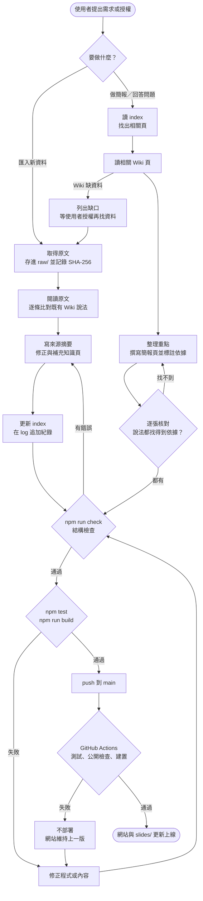

# TeaWIKI 的 loop／graph 設計：從資料到教學簡報

一句話：**資料先變成 Wiki，簡報再從 Wiki 長出來。** AI 不直接拿網路資料做簡報，而是先把原文整理進有來源、可檢查的 Markdown Wiki；要做簡報時，再「查詢 Wiki → 整理 → 核對 → 產生」。每一段都有檢查點，沒過就退回上一步重做。

這個設計參考 Andrej Karpathy 的 LLM Wiki 模式：保留不改寫的原始資料（raw）、由 AI 持續維護的 Wiki、規定流程的 schema（本專案的 AGENTS.md），以及三種操作：ingest（匯入）、query（查詢）、lint（健康檢查）。

## 流程圖

GitHub 會直接把上面的區塊畫成流程圖。

## 每一步在做什麼

| 步驟 | 做什麼 | 產出 |
| --- | --- | --- |
| 取得資料 | 只有使用者明確授權時才連網。下載原文，存進 `raw/articles/`，在 `raw/manifest.json` 記下 SHA-256 指紋 | 不可改寫的原件與指紋 |
| ingest：整理進 Wiki | 讀原文，把現有 Wiki 的每個說法拿去對原文；寫來源摘要、修正或補充知識頁、記下來源之間的差異 | `wiki/sources/`、知識頁、`wiki/log.md` |
| query：查詢 Wiki | 先讀 `wiki/index.md` 找相關頁，再讀那些頁；Wiki 沒有的就說「缺資料」，不靠記憶補 | 要用的知識清單 |
| 整理重點、產生簡報 | 依大綱把知識改寫成給初學者的投影片，每張用「依據」連到 Wiki 頁；成果存回 Wiki | `wiki/syntheses/tea-name-slides.md` |
| 檢查 | 工具做結構檢查與測試；AI 逐張核對內容 | 通過才繼續 |
| 產生網頁 | `npm run build` 把簡報頁轉成 HTML 簡報 | `dist/slides/` |
| 發布 | push 到 main，GitHub Actions 再測一次才部署 | 線上網站 |

## 哪些步驟會重複執行？

1. **ingest 每來一份新資料就跑一次。** 新資料不是貼在最後面，而是回頭修改受影響的舊頁，所以 Wiki 會越來越準，而不是越來越長。
2. **query 每次要回答問題或做簡報就跑一次。** 簡報內容改版時，重新查詢、改簡報頁、再建置。
3. **「撰寫 ↔ 核對」是內圈迴圈。** 核對時發現某句話在依據頁找不到，就退回去改寫或刪掉，直到每句都有依據。
4. **「檢查 → 修正 → 再檢查」是外圈迴圈。** `npm run check`、`npm test`、GitHub Actions 任何一關沒過，都回到修正再跑一次。
5. **lint（健康檢查）定期或被要求時跑。** 找孤立頁、失效連結、概念重複、說法矛盾。

## 哪些地方需要檢查或重新生成？

| 檢查點 | 檢查什麼 | 誰檢查 | 沒過怎麼辦 |
| --- | --- | --- | --- |
| 原件指紋 | 原件有沒有被改過 | `check.mjs` 比對 SHA-256 | 不准改舊檔；要更新就另存新版本 |
| 原文比對 | Wiki 說法是否真的出自原文 | AI 逐條比對，主流程再抽查原文 | 修正或刪除該說法，並在 log 記錄 |
| 結構 | ID、frontmatter、連結、索引漏頁、公開頁不可連到草稿 | `npm run check` | 修正後重跑 |
| 投影片依據 | 封面以外每張是否連到已公開的 Wiki 頁 | `npm run check`（簡報專用規則） | 補上依據，或拿掉沒有依據的投影片 |
| 投影片內容 | 每句話是否真的寫在依據頁裡 | AI 逐張核對 | 退回撰寫步驟重新生成該張 |
| 程式行為 | 管理 API、退役原件、簡報建置等 | `npm test`（14 項） | 修程式後重跑 |
| 部署前 | 在乾淨的雲端環境重跑測試、檢查、建置 | GitHub Actions | 不部署，網站維持上一版 |

工具只能檢查「格式對不對、有沒有依據連結」，不能判斷茶知識是真是假；內容正確性靠「回到原文核對」這一關。

## 為什麼這樣設計？

1. **先 Wiki、後簡報，知識才能累積。** 如果每次都直接叫 AI 上網找資料做簡報，做完就沒了，下一次又要重找，也無法檢查。先整理成 Wiki，同一份知識可以重複用來回答問題、做簡報、做網站。
2. **每句話都能追到來源。** 原文 → 來源摘要 → 知識頁 → 投影片，一路有連結。讀者看到一句話，可以點回去看依據；有錯也知道要改哪裡。
3. **AI 會出錯，所以要設檢查點。** AI 可能把 A 來源的說法掛到 B 來源，或寫出原文沒有的推論。設計上讓「工具檢查格式、AI 回原文核對內容、雲端再測一次」三層把關。
4. **原件不改、紀錄只追加。** 這樣任何時候都能回頭查「當時根據什麼、改了什麼」。
5. **由人決定何時連網。** AI 不會自己排程去搜尋；資料來源由使用者授權，避免無限擴張或引用不可靠的資料。

## 本專案實際發生的例子

- **原文比對抓到錯誤（ingest 的檢查點）**：重新讀原文後發現，「六大茶類」頁的標題「別只猜茶湯顏色」和原文不符，原文說六大茶類正是依色澤與湯色命名；「東方美人」頁的「著蜒」說法引用錯來源；「青心烏龍」頁漏列包種茶。三處都已修正，記在 `wiki/log.md`。
- **交叉核對抓到自己的失誤**：抽 PDF 文字時中文全部遺失，一度誤判茶改場教材「多半是圖片」；負責核對的子流程改用正確編碼重讀，才發現教材只有兩頁、內容完整。這件事寫在該來源頁的限制裡。
- **不能改寫的紀錄怎麼處理**：有一份舊原件遺失、也不再使用。規則不允許刪紀錄或改指紋，所以設計了「退役」標記：保留舊紀錄，另外註明停用日期與原因。
- **部署前的模擬抓到測試問題**：開啟自動部署前，先模擬 GitHub 上「沒有原件」的環境，發現一個測試會失敗並擋下部署，修好後才推送。
- **簡報的內圈迴圈**：簡報的 60 個關鍵說法逐一回到依據頁搜尋，全部找得到才發布。

## 相關檔案

- 規則：[AGENTS.md](../AGENTS.md)（ingest、query、lint 的詳細規定）
- Wiki 入口：[wiki/index.md](../wiki/index.md)；操作紀錄：[wiki/log.md](../wiki/log.md)
- 簡報內容：[wiki/syntheses/tea-name-slides.md](../wiki/syntheses/tea-name-slides.md)；網站上的簡報在 `slides/`
- 工具：`scripts/check.mjs`（結構與依據檢查）、`scripts/build.mjs`（產生網站與簡報）、`tests/admin.test.mjs`（自動測試）
- 需求規格：`openspec/specs/`（網站、發布、簡報等功能需求）
