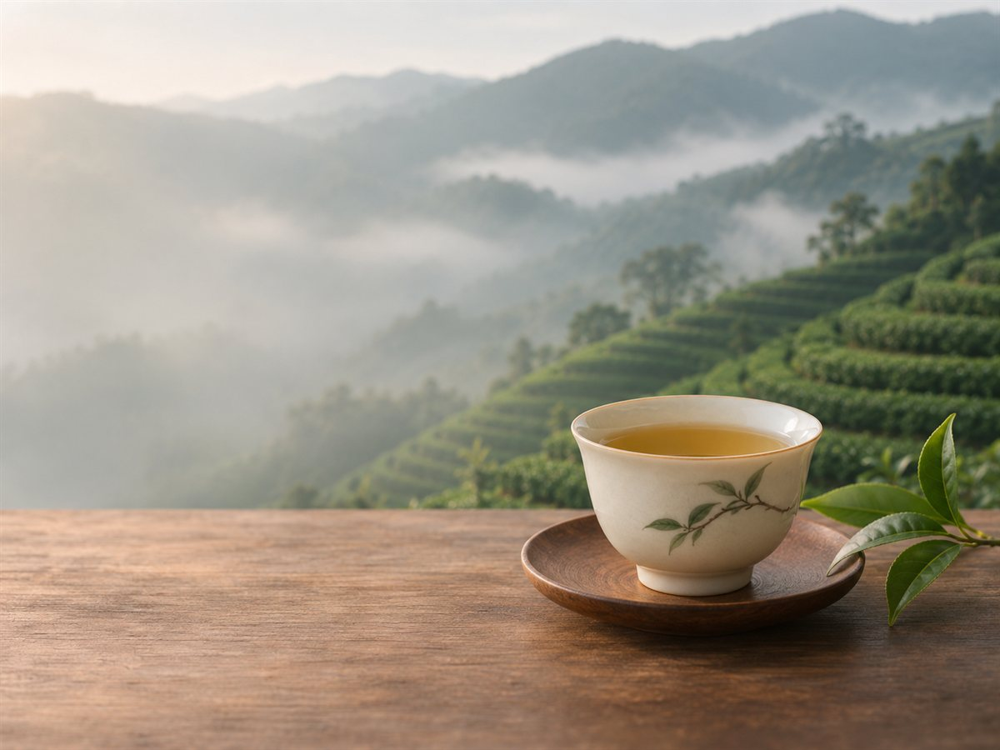
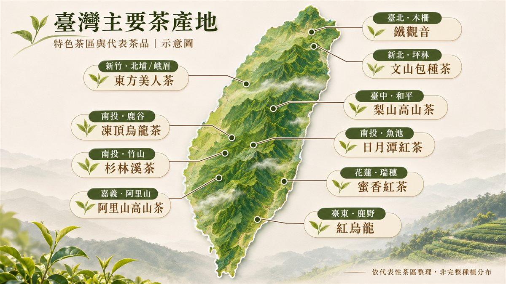
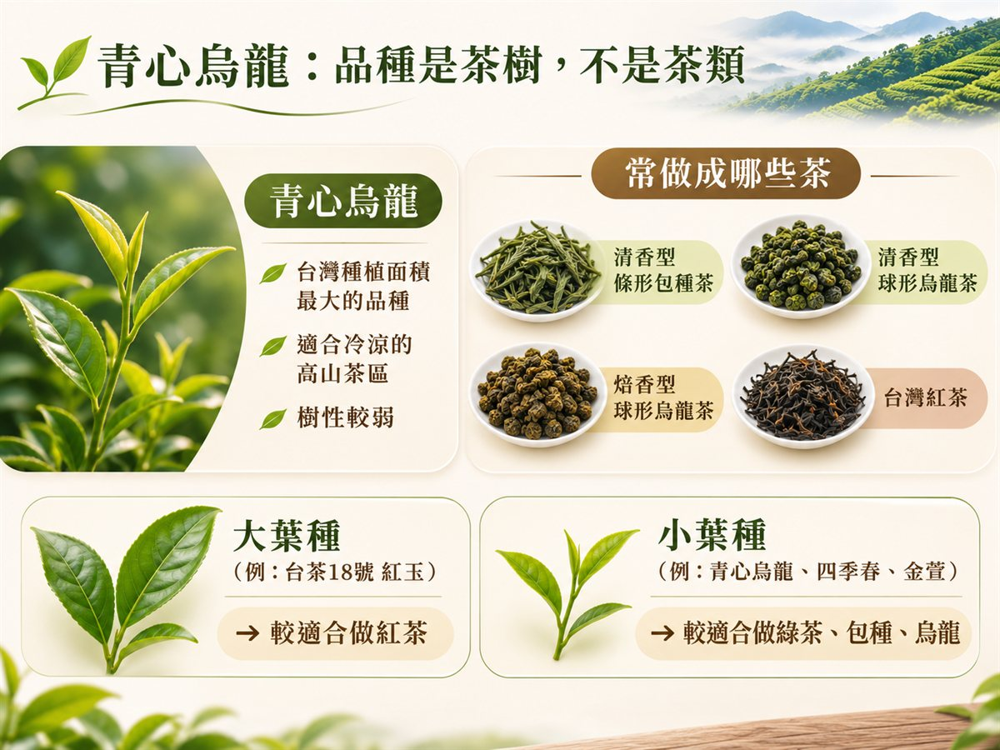
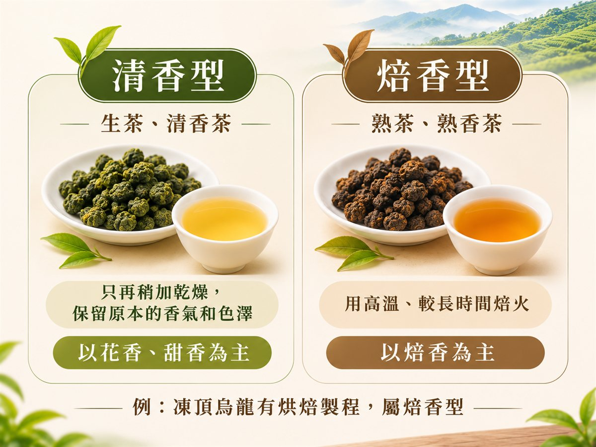
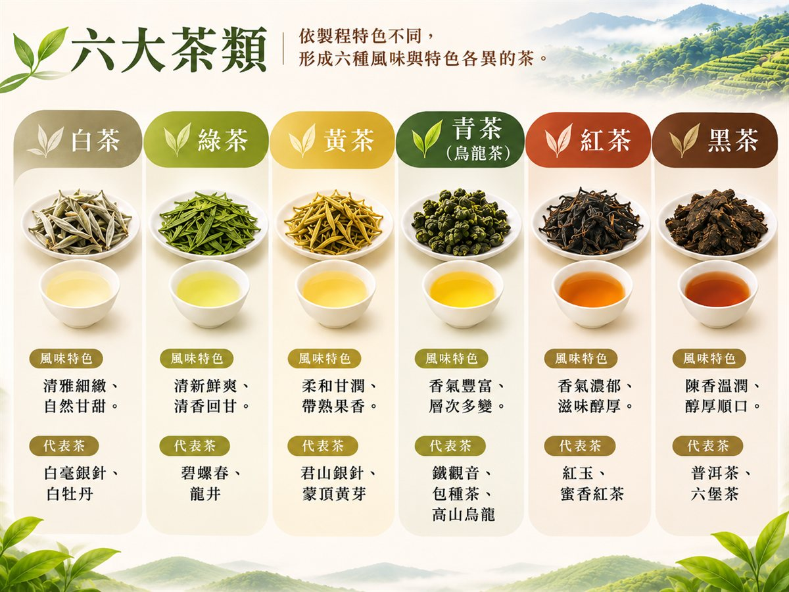
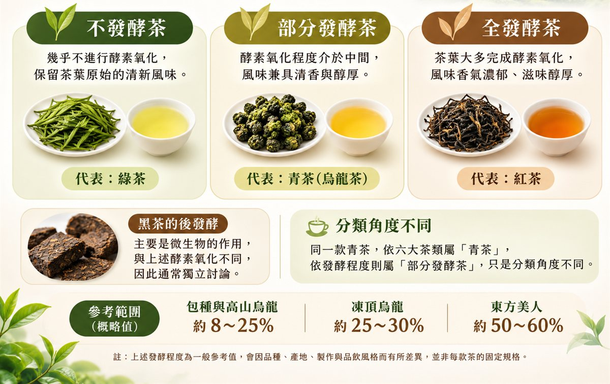
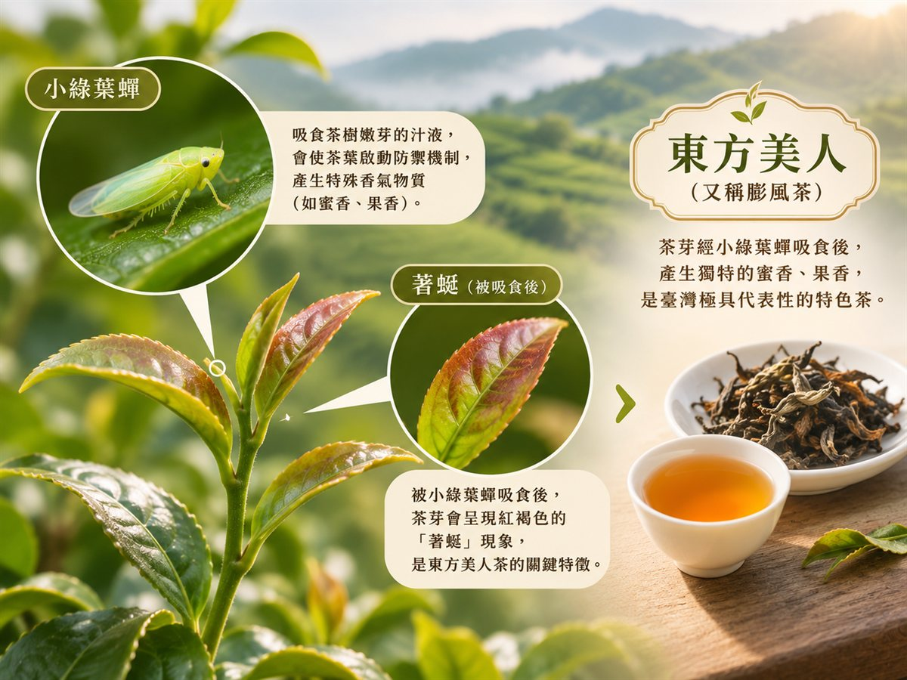
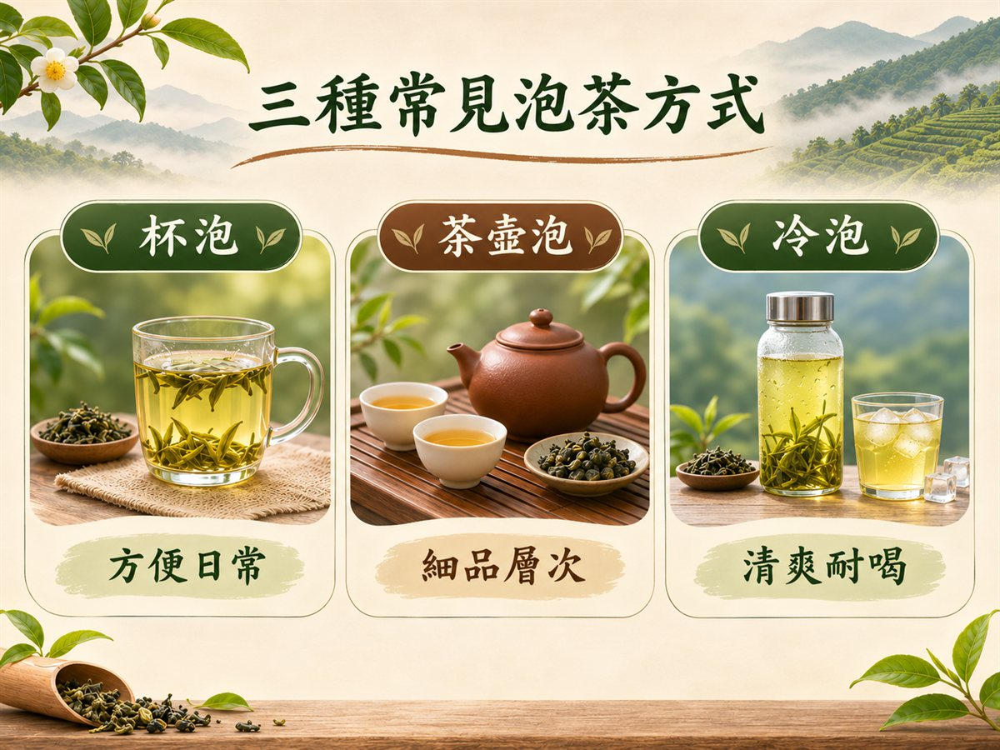

# 從茶名讀懂台灣茶

一個茶名，就像一張小履歷。拆開來讀，你也能看懂台灣茶。

給第一次認識茶的你：不用背名詞，只要學會「分欄看」。

## 一個茶名，其實回答四個問題

> 杉林溪龍鳳峽・青心烏龍・清香型・冬茶

| 茶名裡的詞 | 它在回答 | 放進哪一欄 |
| --- | --- | --- |
| 杉林溪龍鳳峽 | 從哪裡來？ | 產地 |
| 青心烏龍 | 用哪一種茶樹？ | 品種 |
| 清香型 | 做成什麼風格？ | 製作風格 |
| 冬茶 | 什麼時候採的？ | 茶季 |

這是本站的教學組合示例，不是市面上某一款商品。

依據：[茶名示例：杉林溪龍鳳峽・青心烏龍・清香型・冬茶](../tea-names/shanlinxi-qingxin-winter-example.md)。

## 產地：茶名裡的地名

- 用產地替茶命名很常見，例如文山包種茶、凍頂烏龍茶、阿里山高山茶。
- 台灣大致分成五大茶區：北部、桃竹苗、中南部、東部，以及「高山茶區」。
- 高山茶區不是一塊獨立的地方，而是各茶區裡海拔 1,000 公尺以上的範圍。

例子裡的「杉林溪龍鳳峽」放在產地欄。但地名只是線索：1,000 公尺是分類門檻，看不出某包茶實際種在多高。

依據：[茶名裡的地名，告訴你什麼？](../origins/taiwan-tea-origins.md)、[茶名示例](../tea-names/shanlinxi-qingxin-winter-example.md)。

## 品種：青心烏龍是茶樹，不是茶類

- 「品種」是在說用了哪一種茶樹。青心烏龍是台灣種植面積最大的品種，適合生長在冷涼的高山茶區。
- 名字裡有「烏龍」，卻能做成不同的茶：常見的有清香型條形包種茶、清香型與焙香型球形烏龍茶、台灣紅茶。
- 茶樹還可分大葉種、小葉種：大葉種（例如台茶 18 號紅玉）較適合做紅茶；小葉種（例如青心烏龍、四季春、金萱）較適合做綠茶、包種、烏龍。

依據：[青心烏龍：先認識品種，再看做成什麼茶](../cultivars/qingxin-oolong.md)。

## 風格：清香型與焙香型

| | 清香型 | 焙香型 |
| --- | --- | --- |
| 茶行常說 | 生茶、清香茶 | 熟茶、熟香茶 |
| 做法差別 | 只再稍加乾燥，保留原本的香氣和色澤 | 用高溫、較長時間焙火 |
| 風味方向 | 以花香、甜香為主 | 以焙香為主 |

例如凍頂烏龍茶因為有烘焙製程，被歸在焙香型。風格詞是在描述方向，不是完整的製作配方。

依據：[清香型、焙香型：先讀懂風格，再問製作細節](../styles/light-and-roasted-styles.md)。

## 茶季：冬茶，和容易混淆的冬片

- **冬茶**：立冬前後採收，季節表列在約 10 月下旬～11 月下旬。天氣轉涼、茶芽長得慢，香氣清香細膩。
- **冬片**：冬茶採完後，遇到暖冬又長出的嫩芽，產量少又不固定。
- 「冬茶」是茶季的名稱，不是品種，也不是精確的採收日期。

依據：[茶名示例：冬茶｜採收季節](../tea-names/shanlinxi-qingxin-winter-example.md)。

## 白話翻譯：把茶名說成一句話

**範例：杉林溪龍鳳峽・青心烏龍・清香型・冬茶**

翻成白話：

> 一款標示來自杉林溪龍鳳峽、使用青心烏龍品種、在冬茶季採收，並呈現清香風格的茶。

- 這個名稱只告訴你這四件事。
- 它沒有告訴你：實際海拔、完整製程、香氣保證，或該怎麼泡。
- 再提醒一次：這是教學組合示例，不是已找到的同名商品。

依據：[茶名示例：白話翻譯與示範限制](../tea-names/shanlinxi-qingxin-winter-example.md)。

## 六大茶類：名稱看顏色，分辨靠製程

綠、白、黃、青、紅、黑，名稱來自成品的色澤和茶湯顏色；要分辨，得看茶葉採下來以後做了哪些處理。

| 茶類 | 關鍵處理 |
| --- | --- |
| 綠茶 | 蒸菁或炒菁，抑制酵素氧化 |
| 白茶 | 長時間萎凋（讓茶菁失水） |
| 黃茶 | 悶黃 |
| 青茶（烏龍茶類） | 萎凋、靜置攪拌，再炒菁 |
| 紅茶 | 揉捻後讓氧化充分進行 |
| 黑茶 | 渥堆，靠微生物的後發酵 |

依據：[六大茶類入門：名稱看顏色，分辨靠製程](../tea-types/six-tea-types.md)。

## 「發酵」程度：另一種分法

- 也可以依發酵程度分：不發酵茶、部分發酵茶、全發酵茶。同一杯茶可以叫「青茶」，也可以叫「部分發酵茶」，只是角度不同。
- 紅茶、烏龍茶說的發酵，多半是茶葉本身的酵素讓成分氧化；黑茶的後發酵才是靠微生物。
- 參考範圍：包種與高山烏龍約 8～25%、凍頂烏龍約 25～30%、東方美人約 50～60%。這是一般參考值，不是每款茶的固定規格。

依據：[六大茶類入門：兩套分法與發酵](../tea-types/six-tea-types.md)。

## 另一個「六」：台灣特色茶風味輪

- 茶改場把台灣特色茶分成六類，各有一個「風味輪」：台灣綠茶、清香型條形包種茶、清香型球形烏龍茶、焙香型球形烏龍茶、東方美人茶、台灣紅茶。
- 風味大致用五個方向描述：青香、花香、果香、甜香、焙香。
- 這六類不是綠、白、黃、青、紅、黑的改名。看到「六」，先問是哪一套分類。

依據：[六大茶類入門：遇到另一組「六」](../tea-types/six-tea-types.md)。

## 特色茶例子：東方美人

- 東方美人又叫白毫烏龍、膨風茶、椪風茶，是同一款茶的不同名稱。
- 「著蜒」是說茶芽被小綠葉蟬刺吸過。東方美人用這種嫩芽當原料，再經過重萎凋、重攪拌等處理。
- 看到「蜜香」先別急著認定是東方美人：蜜香紅茶也使用著蜒的茶芽。

依據：[東方美人：茶款名稱裡藏著哪些製作線索？](../specialties/oriental-beauty.md)。

## 沖泡：先問怎麼泡，再看秒數

| 泡法 | 資料裡的建議 |
| --- | --- |
| 杯泡（茶葉） | 3 克配 150 毫升滾水，約 5 分鐘，視品種而異 |
| 茶壺法 | 第一泡約 60 秒，之後每泡多 15～20 秒 |
| 冷泡 | 1 克配 200 毫升冷開水，室溫約 2 小時或冰箱約 10 小時 |

同一款茶，泡法不同，數字就差很多。先照包裝建議泡，再依經驗調整。

依據：[泡茶先別背一套秒數：先看器具，再調整](../brewing/brewing-basics.md)。

## 讀茶名的三個提醒

- **分欄看**：產地、品種、風格、茶季，各自回答不同的問題，別混成一欄。
- **名稱是線索，不是履歷**：看不出實際海拔、完整製程或品質。
- **遇到不懂的詞**：先問「它在回答哪一個問題」，再去查那一欄的知識。

依據：[茶名示例：示範限制](../tea-names/shanlinxi-qingxin-winter-example.md)、[茶名裡的地名](../origins/taiwan-tea-origins.md)。

## 小練習：拆拆看「阿里山・青心烏龍」

- 「阿里山」放哪一欄？→ 產地
- 「青心烏龍」放哪一欄？→ 品種
- 這個名稱沒寫什麼？→ 製作風格和茶季，要另外看商品說明。

這是閱讀練習，不是在介紹某一款商品。

依據：[茶名裡的地名：看茶單時，可以分兩次問](../origins/taiwan-tea-origins.md)。

## 這份簡報的資料從哪裡來

- 由 AI 先讀 Wiki 索引與相關頁面後整理；每張下方都標出依據的 Wiki 頁。
- Wiki 的知識來自 8 份已封存並逐份讀過的原文，主要是農業部食農教育資訊整合平臺、茶及飲料作物改良場、國立臺灣科學教育館的公開資料；茶名示例的產地寫法另參考一份業者商品頁。
- 內容不是官方背書，也不是商品鑑定；本簡報不談茶的療效。

依據：[逗陣來識茶](../sources/moa-tea-intro.md)、[冬片仔知多少](../sources/moa-winter-harvest.md)、[特色茶分類及加工製程](../sources/moa-tea-process.md)、[臺茶風味輪](../sources/moa-flavor-wheel.md)、[科教館：青心烏龍](../sources/ntsec-qingxin.md)、[尋茶趣教案](../sources/school-tea-practice.md)、[茶改場教材](../sources/tbrs-taiwan-tea-handout.md)、[業者商品頁](../sources/teawei-longfengxia.md)。

## 維護註記

2026-11-22 依 Wiki query 產生（讀取頁見 wiki/log.md）。

逐張核對：共 15 張（封面加 14 張）。把 14 張中的 60 個關鍵說法與數字，逐一到該張引用的 Wiki 頁搜尋，全部找得到；其中 2 處只是用字不同（「不是已找到的同名商品」「蜜香紅茶使用著蜒原料」），意思一致，未修改。沒有加入 Wiki 以外的茶知識或療效說法。check 只能確認每張都有依據連結，內容正確性以這次核對為準。

2026-11-22 加入使用者提供的 AI 生成圖片：第 1、3、8、9、11、12 張使用，圖說標明示意與未查證；第 4、5 張原圖與 Wiki 矛盾，已由使用者依只含 Wiki 文字的 prompt 重生，圖中文字逐字核對一致後使用。第 9 張曾改為標題加圖片，之後依使用者要求改回文字在左、圖片在右，三點文字與 query 產生時相同；圖片裁掉了上方標題區。圖片出處見 assets/image-credits.json。
